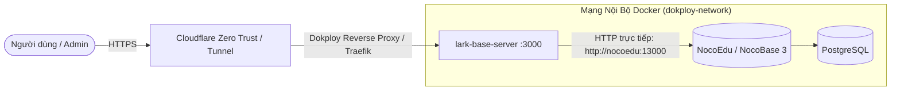

# Hướng Dẫn Triển Khai Lark Base ETL Service Trên Dokploy (VPS)

> Tài liệu hướng dẫn thiết lập và triển khai dịch vụ Web UI & REST API ETL (`@duongsinh/lark-base-server`) chạy song song với **NocoEdu (NocoBase 3)** trên nền tảng Dokploy.

---

## 1. Kiến Trúc Mạng Nội Bộ (Docker Internal Network)

Trên VPS Dokploy, NocoBase 3 và `lark-base-server` được kết nối qua Docker Network nội bộ chung (`dokploy-network`):



- **Ưu điểm vượt trội:**
  - Tốc độ truyền tải nội bộ cực cao (Gbps, không qua Internet).
  - Không cần mở port NocoBase ra ngoài public Internet.
  - Bảo mật tối đa.

---

## 2. Các Bước Cài Đặt Trên Dokploy Dashboard

### Bước 2.1: Tạo Ứng Dụng Mới (Application)
1. Đăng nhập vào Dokploy.
2. Chọn Project của bạn (ví dụ: `NocoEdu Project`).
3. Nhấn **Create Application** $\rightarrow$ Chọn **Compose** (hoặc **Git Repository**).
4. Điền tên: `lark-base-etl`.

### Bước 2.2: Cấu Hình Biến Môi Trường (Environment Variables)
Trong tab **Environment**, thiết lập các biến sau:

```env
PORT=3000
HOST=0.0.0.0
NODE_ENV=production

# Tên service hoặc container của NocoBase trên Dokploy
NOCOBASE_URL=http://nocoedu:13000
NOCOBASE_API_KEY=your_nocobase_api_key_here

# Bảo vệ trang Web UI và API bằng Basic Auth
AUTH_USER=admin
AUTH_PASS=mat_khau_bao_mat_cua_ban
```

### Bước 2.3: Gắn Domain & SSL
1. Trong tab **Domains**, nhấn **Add Domain**.
2. Nhập domain nội bộ, ví dụ: `etl.nocoedu.yourdomain.com`.
3. Chọn Certificate: **Let's Encrypt** (hoặc Cloudflare Origin Certificate).
4. Port container trỏ tới: `3000`.

### Bước 2.4: Bảo Vệ Truy Cập (Security Options)
Hệ thống hỗ trợ 2 lớp bảo vệ linh hoạt:
1. **Lớp 1: Basic Auth tích hợp sẵn:**
   - Được kích hoạt tự động khi bạn điền `AUTH_USER` và `AUTH_PASS`.
2. **Lớp 2: Cloudflare Zero Trust (Khuyên Dùng):**
   - Thiết lập Cloudflare Access Application cho domain `etl.nocoedu.yourdomain.com`.
   - Yêu cầu đăng nhập OTP qua Email của nhân viên quản trị.
   - Header `cf-access-authenticated-user-email` từ Cloudflare được `lark-base-server` nhận diện và cho phép truy cập an toàn.

---

## 3. Quy Trình Sử Dụng Web UI (1 Chạm)

1. Truy cập vào domain `https://etl.nocoedu.yourdomain.com`.
2. Kéo thả file sao lưu `.base` của Lark Base vào khung tải lên.
3. Xem tóm tắt phân tích (Inspect):
   - Tổng số bảng và dòng.
   - 3 bảng điểm danh các năm 2024, 2025, 2026 tự động được gộp thành `attendances_feedbacks`.
   - Các bảng rác và bảng lưu trữ mẫu tự động bị loại bỏ.
   - Thông tin phụ huynh tự động được tách thành bảng `parents` riêng biệt và liên kết khóa ngoại với `students`.
4. Nhấn nút: **"⚡ 1 Chạm: Tự Động Đẩy Sang NocoEdu"**.
5. Theo dõi tiến trình tải real-time và kiểm tra dữ liệu xuất hiện ngay trên NocoEdu!

---

## 4. Tải Xuất Dữ Liệu Ẩn Danh Hóa (Data Privacy & Compliance)

Ngay trên giao diện Web UI, bạn có thể tải bản sao dữ liệu đã được ẩn danh hóa (xóa số CCCD, mask số điện thoại `090****123`, viết tắt họ tên cá nhân):
- **Tải SQLite (`.sqlite`):** Đầy đủ cơ sở dữ liệu quan hệ, sẵn sàng mở bằng SQLite Viewer / DBeaver.
- **Tải JSON:** File cấu trúc chuẩn cho tất cả bảng NocoEdu.
- **Tải CSV:** Định dạng bảng tính dễ dàng mở bằng Excel hoặc Google Sheets.
