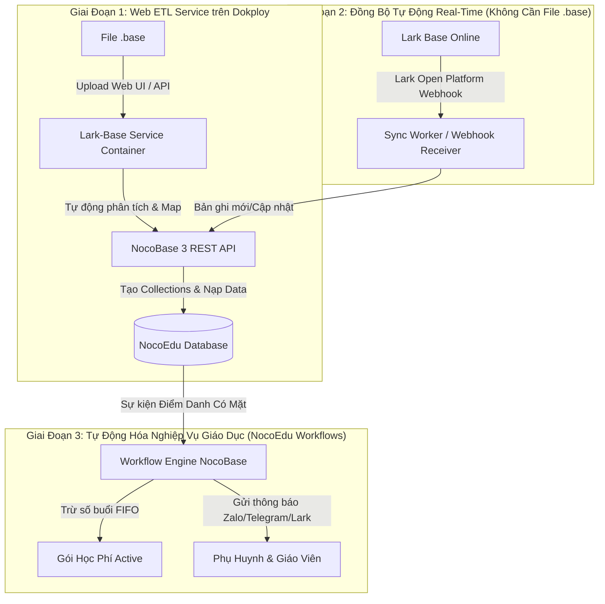

# Lộ Trình Tự Động Hóa Toàn Diện: Lark Base $\rightarrow$ NocoEdu (NocoBase 3)

> **Mục tiêu tối thượng:** Đạt mức độ tự động hóa cao nhất (Zero-Manual-Effort) trong việc trích xuất, đồng bộ và vận hành dữ liệu từ Lark Base sang NocoEdu / NocoCRM trên hạ tầng VPS Dokploy.

---

---

## Giai Đoạn 1: Docker Web Service & Pipeline Tự Động Nạp NocoBase 3 (Dokploy)

### 1. Mục tiêu
- Xây dựng container web service `packages/server` (Fastify / Hono + TypeScript) chạy cạnh NocoBase trên Dokploy.
- Cung cấp Web UI kéo-thả file `.base` và REST API endpoint tự động nạp thẳng vào NocoBase.
- Không cần cấu hình tay từng bảng trên NocoBase: Hệ thống tự động gọi API NocoBase để tạo Collection, Fields, Relationships và batch insert bản ghi.

### 2. Các thành phần cần triển khai
1. **Module `packages/server`:**
   - Framework siêu nhẹ: Hono hoặc Fastify (Node.js).
   - Endpoints:
     - `POST /api/upload`: Nhận file `.base`, lưu tạm và trả về phân tích inspect.
     - `POST /api/migrate`: Chạy pipeline ETL:
       - Ẩn danh hóa (anonymization).
       - Gọi NocoBase API (`/api/collections`, `/api/fields`) để tự động tạo schema.
       - Batch import các bản ghi theo thứ tự ưu tiên quan hệ (Dependencies graph: `levels` $\rightarrow$ `teachers` $\rightarrow$ `classes` $\rightarrow$ `students` $\rightarrow$ `deals` $\rightarrow$ `attendances`).
   - Web UI tối giản (Single-file HTML/Vue hoặc React bundle gọn gàng) có thanh tiến trình (progress bar).
2. **Cấu hình Docker & Dokploy:**
   - `Dockerfile` đa tầng (multi-stage build) tối ưu dung lượng (< 150MB).
   - `docker-compose.yml` kết nối chung Docker network với NocoBase (`nocoedu_network`).
   - Cấu hình biến môi trường (`NOCOBASE_URL=http://nocoedu:13000`, `NOCOBASE_API_KEY=...`).
3. **Bảo mật truy cập:**
   - Tích hợp Basic Auth hoặc Cloudflare Zero Trust để bảo vệ domain nội bộ.

---

## Giai Đoạn 2: Đồng Bộ Tự Động Hai Chiều / Thời Gian Thực (Lark Open API)

### 1. Mục tiêu
- Loại bỏ hoàn toàn thao tác con người phải vào Lark bấm xuất file `.base`.
- Mọi thay đổi trên Lark Base lập tức tự động cập nhật sang NocoEdu trong vòng 1-2 giây.

### 2. Các thành phần cần triển khai
1. **Đăng ký Lark Custom App (Lark Open Platform):**
   - Cấp quyền đọc/ghi Base (`bitable:app`, `bitable:app:readonly`).
   - Lấy App ID & App Secret.
2. **Webhook Listener Service:**
   - Endpoint nhận sự kiện: `POST /api/lark-webhook` (xác thực `challenge` và `signature` của Lark).
   - Bắt các sự kiện:
     - `bitable.record.created`: Khi có Contact/Lead mới hoặc đơn nộp học phí mới.
     - `bitable.record.updated`: Khi trạng thái chuyển đổi hoặc cập nhật thông tin học viên.
3. **Queue & Retry Worker (BullMQ / P-Queue):**
   - Đảm bảo không mất dữ liệu khi NocoBase bảo trì hoặc mạng gián đoạn.

---

## Giai Đoạn 3: Tự Động Hóa Nghiệp Vụ Giáo Dục Trên NocoEdu

### 1. Mục tiêu
- Biến NocoEdu thành hệ thống quản lý tự vận hành, không cần kế toán/giáo vụ trừ buổi thủ công bằng Excel.

### 2. Các quy tắc tự động hóa cốt lõi
1. **Quy tắc Trừ Buổi Học (Session Ledger Deduction):**
   - *Trigger:* Bản ghi `attendances_feedbacks` có trạng thái `có mặt = true` (hoặc `status = 'present'`).
   - *Logic:* Tìm gói học phí (`tuition_deals`) của học sinh có `remaining_sessions > 0` và `deal_date` sớm nhất (FIFO).
   - *Action:*
     - `remaining_sessions = remaining_sessions - 1`
     - `attended_sessions = attended_sessions + 1`
     - Nếu `remaining_sessions == 0`: Đổi trạng thái gói thành `Completed`.
2. **Quy tắc Cảnh Báo Hết Buổi / Tái Tục Học Phí:**
   - *Trigger:* Khi `remaining_sessions <= 2`.
   - *Action:* Tự động kích hoạt thông báo (qua Zalo ZNS / Telegram Bot / Lark Bot) cho nhân viên CSKH và phụ huynh học sinh.
3. **Quy tắc Báo Cáo Buổi Học Cho Phụ Huynh:**
   - *Trigger:* Giáo viên hoàn thành nhận xét buổi học.
   - *Action:* Tự động gửi tin nhắn nhận xét đến tài khoản Zalo / Email của phụ huynh.

---

## Ma Trận Ưu Tiên & Kế Hoạch Triển Khai Chi Tiết

| Giai đoạn | Nhiệm vụ chính | Kết quả bàn giao | Mức độ ưu tiên |
|:---:|---|---|:---:|
| **P1.1** | Xây dựng Web API & Server Container (`packages/server`) | Web UI kéo thả + REST API xử lý file `.base` | 🔴 Cao nhất |
| **P1.2** | Script tự động tạo Collections & Fields trên NocoBase 3 | Tự động sinh schema NocoEdu qua API | 🔴 Cao nhất |
| **P1.3** | Đóng gói Docker & Cấu hình Dokploy | File `Dockerfile`, `docker-compose.yml`, domain setup | 🔴 Cao nhất |
| **P2.1** | Tích hợp Lark Open Platform Webhooks | Real-time Sync không cần bấm xuất file `.base` | 🟡 Trung bình |
| **P3.1** | Xây dựng Workflow Trừ Buổi & Thông Báo trên NocoBase 3 | Tự động hóa vận hành lớp học & điểm danh | 🟢 Kế tiếp |
